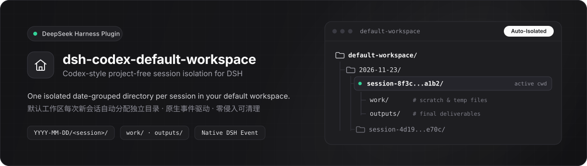
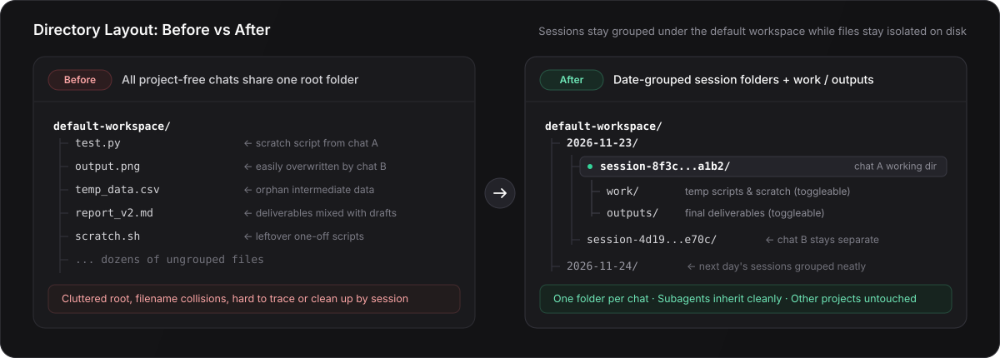
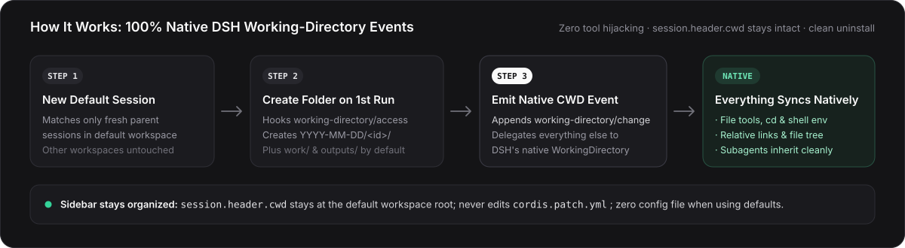

<p align="center">
  
</p>

<div align="center">

# dsh-codex-default-workspace

**Codex-style per-session directory isolation for DeepSeek Harness's default workspace**

[简体中文](README.md) · English

[](https://www.npmjs.com/package/dsh-codex-default-workspace)
[](https://www.npmjs.com/package/dsh-codex-default-workspace)
[](LICENSE)
[](https://nodejs.org/)
[](https://github.com/deepseek-ai/deepseek-harness)

</div>

> A community plugin for [DeepSeek Harness (DSH)](https://github.com/deepseek-ai/deepseek-harness) that brings Codex-style project-free sessions to your **default workspace**: each new session automatically gets its own date-grouped directory (`YYYY-MM-DD/<session-id>/`) on first run instead of cluttering the root folder.

---

## Before vs After

<p align="center">
  
</p>

## Features

- **Automatic Per-Session Folders**: On first working-directory access, each new session in the default workspace creates and enters `<default-workspace>/YYYY-MM-DD/<session-id>/`.
- **Built-in `work/` & `outputs/` Convention (Enabled by Default, Toggleable)**: Automatically creates `work/` (scratch scripts and intermediate files) and `outputs/` (final deliverables), and adds a brief reminder for both the main session and subagents inside the session tree. Other workspaces are never touched.
- **100% Native DSH Behavior**: Keeps `session.header.cwd` at the default workspace root (so sidebar grouping stays intact) while emitting a native `working-directory/change` event—file tools, `cd`, shell terminals, relative chat links, and the file tree all sync natively.
- **Scoped & Non-Intrusive**: Project workspaces stay untouched; existing multi-turn sessions in the default workspace keep their original cwd; subagents inherit the parent session directory without creating nested folders.
- **Zero-Bloat Persistence & One-Click Reset**: Never edits host `cordis.patch.yml` (changes apply immediately); creates **no external config file** while using defaults, stores custom settings in `~/.dsh/storages/codex-default-workspace.json`, and supports one-click cleanup.

## How It Works

<p align="center">
  
</p>

<details>
<summary>Default workspace resolution order & technical details</summary>

### Default Workspace Resolution Order

The plugin resolves the default workspace in the following order (always matched by internal workspace ID so renaming never breaks it):

1. Explicit workspace selected by the user (via sidebar context menu or Settings);
2. DSH native `defaultWorkspaceId` (when that workspace still exists);
3. A workspace titled `默认工作区` / `default-workspace` / `Default workspace`, or whose folder name is `default-workspace`.

If none is found, the plugin stays idle and shows a one-time guidance notice.

### Native Event Design

- Hooks `working-directory/access` for brand-new parent sessions in the default workspace, creates the session folder on disk, and appends a native `working-directory/change` event before delegating to DSH's built-in `WorkingDirectoryService`.
- After disabling or uninstalling, new sessions use the default workspace root directly while existing sessions retain their folders and files.

</details>

## Installation

### Option 1: DSH Plugin Market (Recommended)

Search for `dsh-codex-default-workspace` in the DSH Plugin Market and install it directly.

### Option 2: Ask Your Agent to Install

Send this prompt to an Agent with terminal access:

```text
Please install dsh-codex-default-workspace into my active DSH profile and let me know when to reload.
```

### Option 3: CLI

```sh
# Replace <profile> with your active profile (e.g., desktop or web)
dsh plugin --profile <profile> add dsh-codex-default-workspace

# Or install directly from GitHub
dsh plugin --profile <profile> add HelloWorldGitHub114/dsh-codex-default-workspace
```

## Settings & Clean Uninstall

| Entry Point | Actions |
| --- | --- |
| **Sidebar Workspace Context Menu (`···`)** | One-click **Set as default workspace** |
| **Settings → Default workspace** | Pick default workspace, toggle `work / outputs` convention, or reset & remove config file |
| **Plugins → Plugin Details Card** | Shares the same live settings panel; changes apply immediately without restart |
| **Slash Command `/codex-default-workspace-clear`** | Deletes `~/.dsh/storages/codex-default-workspace.json` and restores defaults |

> Resetting settings or uninstalling the plugin **never** deletes created folders on disk or session history.

## License

[MIT](LICENSE)
