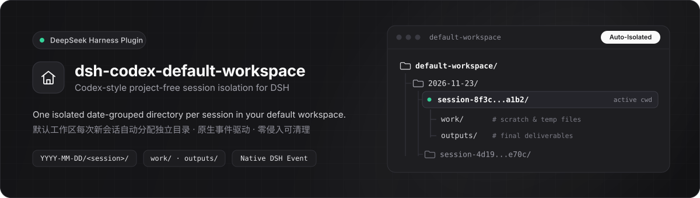
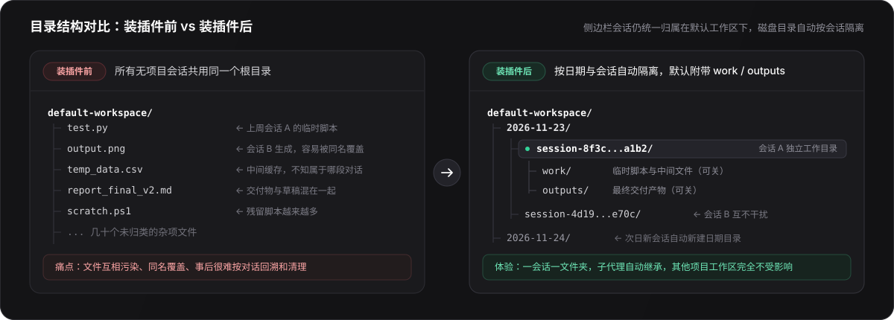
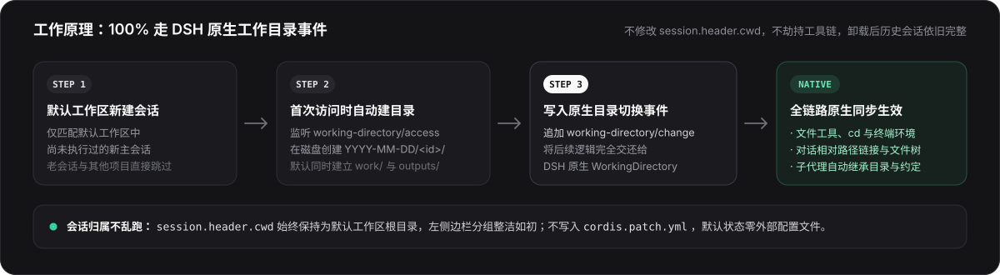

<p align="center">
  
</p>

<div align="center">

# dsh-codex-default-workspace

**让 DeepSeek Harness 的默认工作区拥有 Codex 式「一会话一独立目录」体验**

简体中文 · [English](README.en.md)

[](https://www.npmjs.com/package/dsh-codex-default-workspace)
[](https://www.npmjs.com/package/dsh-codex-default-workspace)
[](LICENSE)
[](https://nodejs.org/)
[](https://github.com/deepseek-ai/deepseek-harness)

</div>

> 社区维护的 [DeepSeek Harness (DSH)](https://github.com/deepseek-ai/deepseek-harness) 插件：在**默认工作区**中新建的每段会话，首次运行时自动分配按日期分组的独立子目录（`YYYY-MM-DD/<会话ID>/`），告别临时文件堆满根目录的困扰。

---

## 前后对比

<p align="center">
  
</p>

## 核心特性

- **自动按日期与会话隔离**：默认工作区的新会话首次访问工作目录时，自动创建并进入 `<默认工作区>/YYYY-MM-DD/<会话ID>/`。
- **内置 `work/` 与 `outputs/` 约定（默认开启，可随时关闭）**：自动建立 `work/`（临时脚本与中间文件）与 `outputs/`（最终交付物），并向主会话及同目录树内的子代理注入简短约定提示；非默认工作区不受影响。
- **100% 走 DSH 原生工作目录机制**：保持 `session.header.cwd` 指向默认工作区根目录不变（侧边栏分组整洁如初），文件工具、`cd`、终端、相对路径链接与右侧文件树全部原生同步。
- **安全边界清晰**：其他项目工作区原样保留；默认工作区中已有多轮记录的老会话不会被强制迁移；子代理自动继承父会话目录，不会重复套娃建文件夹。
- **绿色零侵入，支持一键清理**：不改动宿主 `cordis.patch.yml`，设置即时生效；默认状态下**零外部配置文件**，仅修改非默认项时保存至 `~/.dsh/storages/codex-default-workspace.json`，可随时一键清理。

## 工作原理

<p align="center">
  
</p>

<details>
<summary>展开查看默认工作区识别顺序与技术细节</summary>

### 默认工作区识别顺序

插件按以下优先级确定要接管的默认工作区（内部均按工作区 ID 匹配，重命名不影响生效）：

1. 用户手动指定的工作区（通过侧边栏右键菜单或设置页选择）；
2. DSH 原生记录的默认工作区 `defaultWorkspaceId`（对应工作区仍存在时）；
3. 标题为 `默认工作区` / `default-workspace` / `Default workspace`，或目录名为 `default-workspace` 的工作区。

若以上均未找到，插件保持静默不接管任何会话，并在界面给出一次性引导提示。

### 原生事件机制

- 在 `working-directory/access` 钩子中仅为默认工作区的新主会话建目录，并追加一条原生 `working-directory/change` 事件，随后直接交给 DSH 原生 `WorkingDirectoryService` 处理。
- 停用或卸载插件后，新建会话自动恢复直接使用默认工作区根目录，历史会话仍保留各自的独立子目录与全部文件。

</details>

## 安装方式

### 方式一：DSH 插件市场（推荐）

在 DSH 的插件市场中搜索 `dsh-codex-default-workspace` 并直接安装。

### 方式二：让 Agent 帮你安装

将下面这句话发给具备终端权限的 Agent：

```text
请帮我把 dsh-codex-default-workspace 安装到当前使用的 DSH profile，安装完成后提示我重新加载。
```

### 方式三：命令行安装

```sh
# 将 <profile> 替换为实际使用的 profile（如 desktop 或 web）
dsh plugin --profile <profile> add dsh-codex-default-workspace

# 或直接从 GitHub 安装
dsh plugin --profile <profile> add HelloWorldGitHub114/dsh-codex-default-workspace
```

## 设置与清理

| 入口 | 可执行操作 |
| --- | --- |
| **侧边栏工作区右键 / `···` 菜单** | 一键将任意工作区「设为默认工作区」 |
| **设置 → 默认工作区** | 切换默认工作区、开关 `work / outputs` 约定、一键恢复默认并清理配置文件 |
| **插件管理 → 插件详情卡片** | 与设置页共用同一配置面板，修改立即生效，无需重启插件 |
| **斜杠命令 `/codex-default-workspace-clear`** | 删除 `~/.dsh/storages/codex-default-workspace.json` 并恢复默认设置 |

> 清理配置与卸载插件均**不会**删除已创建的磁盘文件夹或历史会话记录。

## 许可证

[MIT](LICENSE)
